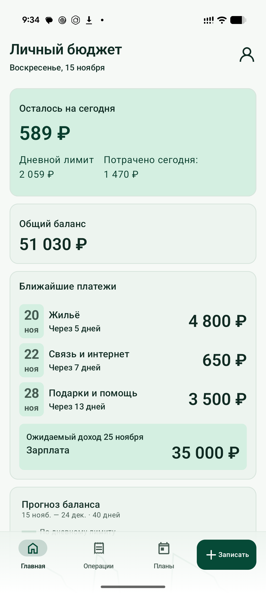
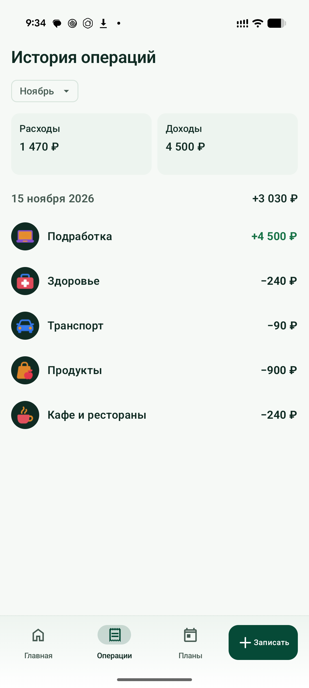
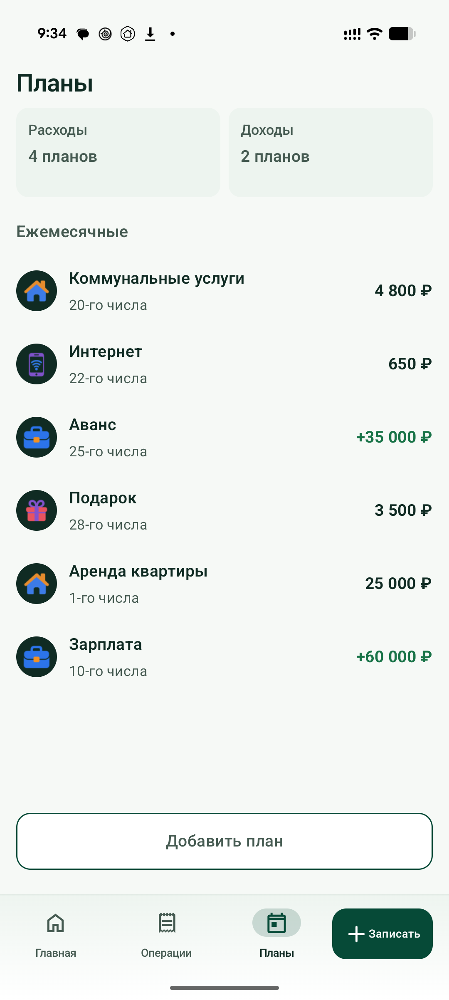
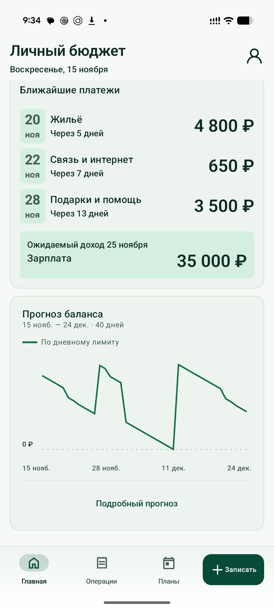
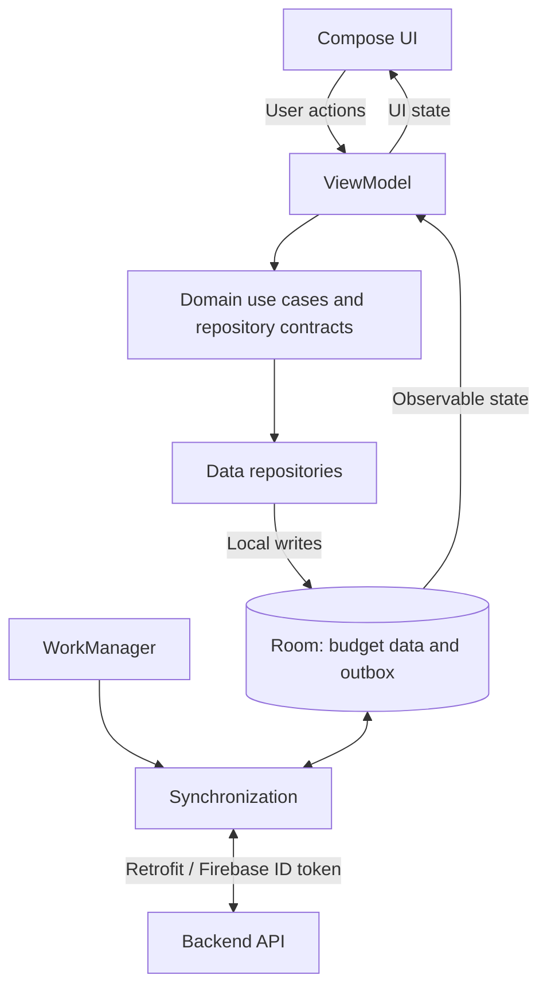

# Saldomi

**A family budget planner for Android, built to work offline.**

Saldomi helps households track income and expenses, plan upcoming payments, and understand how much they can spend each day. Budget changes are saved locally first and synchronized with the backend when cloud sync is enabled and a connection is available.

Start with a local budget without an account, then connect it to your account to synchronize data and share a budget with family members.

**Android 13+ · Kotlin · Jetpack Compose · Offline-first · Version 0.3**

## Screenshots

Screenshots will be added here.

<table>
  <tr>
    <th>Dashboard</th>
    <th>Transactions</th>
    <th>Planning</th>
    <th>Budgets</th>
  </tr>
  <tr>
    <td></td>
    <td></td>
    <td></td>
    <td></td>
  </tr>
</table>

## Features

- **Offline budgeting:** create a local budget and record changes without signing in or connecting to the internet.
- **Income and expense tracking:** add categorized transactions, review history by period and type, edit transaction details, and record expense refunds.
- **Spending insights:** see your balance, available funds, daily spending limit, and a 30-day balance forecast when enough history is available.
- **Payment planning:** manage one-time, weekly, biweekly, and monthly income and expense rules, and link actual transactions to planned payments.
- **Custom categories:** organize income and expenses with editable categories and illustrated icons.
- **Multiple budgets:** switch between separate local and cloud budgets, each with its own data and pending changes.
- **Family sharing:** invite members by code and manage owner/member access to a shared cloud budget.
- **Optional accounts and sync:** sign in with Google or email/password, connect a local budget to your account, and inspect synchronization status and pending changes.
- **Budget currencies and themes:** choose KZT, RUB, USD, or EUR as the budget currency, with light and dark themes following the system setting.

Each budget uses a single accounting currency. Changing it changes the unit of existing amounts; it does not perform currency conversion. The current interface is in Russian.

## Technology stack

| Area | Technologies |
| --- | --- |
| Language and concurrency | Kotlin, Coroutines, Flow / StateFlow |
| User interface | Jetpack Compose, Material 3 |
| Navigation | AndroidX Navigation 3 |
| Presentation | ViewModel, MVVM + MVI, unidirectional data flow |
| Local persistence | Room / SQLite |
| Networking | Retrofit, OkHttp, Kotlin Serialization |
| Background work | WorkManager |
| Dependency injection | Koin |
| Authentication | Firebase Authentication, Credential Manager, Google Identity |
| Testing | JUnit, Coroutines Test, MockWebServer, Compose UI tests, Room testing |
| Build and quality | Gradle Kotlin DSL, KSP, Android Lint, Detekt, ktlint |

Dependency versions are maintained in [gradle/libs.versions.toml](gradle/libs.versions.toml).

## Architecture

The project uses a **feature-first structure with Clean Architecture layers** inside a single Android application module (`:app`):

- **UI:** Compose screens and components render state and send user actions to ViewModels.
- **Domain:** models, repository contracts, and use cases describe business behavior.
- **Data:** repository implementations coordinate Room storage, Retrofit APIs, and synchronization.

Presentation follows **MVVM + MVI** with **unidirectional data flow**: actions enter a ViewModel, state updates flow back to the UI, and one-time effects handle events such as navigation and messages. Shared MVI infrastructure in `core/mvi` provides reducers, interactors, commands, events, and effects.

### Offline-first data flow

Room is the source of data for budget screens. Financial changes and their queued commands are persisted locally before cloud delivery, so the UI can reflect changes immediately.



Cloud synchronization pulls server changes, sends queued commands, and pulls again to refresh the local view. Persisted request IDs support retries without duplicating financial operations. Separate budget databases and Koin scopes isolate each budget's state and queue. Cloud budgets require an initial online download before they are available offline.

### Source layout

```text
app/src/main/java/com/firkat/fillin/
├── core/                 # Shared MVI, DI, database, and networking infrastructure
├── feature/              # Feature packages, organized into data / domain / ui
│   ├── auth/
│   ├── budgetprofile/
│   ├── budgetsharing/
│   ├── categories/
│   ├── dailylimit/
│   ├── dashboard/
│   ├── operationhistory/
│   ├── plannedoperations/
│   └── sync/
├── ui/                   # Shared components, icons, themes, and navigation
└── utils/
```

The source package (`com.firkat.fillin`) and Gradle project name (`Fillin`) retain the project's earlier name.

## Build and run

### Requirements

- Android Studio compatible with the project's Android Gradle Plugin (**9.5.1**).
- **JDK 21**, as specified by [the Gradle daemon configuration](gradle/gradle-daemon-jvm.properties).
- **Android SDK Platform 37**, with SDK Build-Tools and Platform-Tools installed through SDK Manager.
- An emulator or device running **Android 13 / API 33** or newer.

The project targets API 37 and includes the **Gradle 9.6.0** wrapper. Use the wrapper instead of a separately installed Gradle distribution.

### Local development

1. Clone the repository and open its root directory in Android Studio:

   ```bash
   git clone https://github.com/firkatdavletov/FillinAndroid.git
   cd FillinAndroid
   ```

2. Configure JDK 21 for Gradle and install the required SDK packages. Let Android Studio create `local.properties`, or add your SDK path manually:

   ```properties
   sdk.dir=/absolute/path/to/Android/sdk
   ```

3. Sync the project and build the debug APK:

   ```bash
   ./gradlew :app:assembleDebug
   ```

4. Run the `app` configuration in Android Studio, or install it on a connected test device:

   ```bash
   ./gradlew :app:installDebug
   ```

The APK is written to `app/build/outputs/apk/debug/app-debug.apk`. The debug application ID is `com.firkat.fillin.debug`, allowing it to coexist with the release app (`com.firkat.fillin`). On Windows, use `gradlew.bat` in place of `./gradlew`.

**Firebase configuration is optional for local use.** Without it, choose the guest option on the sign-in screen and create a local budget.

### Optional cloud setup

To enable authentication and cloud features:

1. Configure Firebase Authentication with Google and/or Email/Password providers. For Google sign-in, register the signing certificate fingerprints and include a Web OAuth client in the configuration.
2. Register the appropriate application IDs and place their Firebase configuration files at:
   - Debug: `app/src/debug/google-services.json` for `com.firkat.fillin.debug`.
   - Release: `app/google-services.json` for `com.firkat.fillin`.
3. Use a compatible backend configured for the same Firebase project. To override the backend URL, add the following to `local.properties`:

   ```properties
   FIREBASE_API_BASE_URL=https://your-backend.example/
   ```

   The URL must use HTTPS and end with `/`. It can also be supplied as the Gradle property `-PfirebaseApiBaseUrl=https://your-backend.example/`.
4. Rebuild the app, sign in, and create a cloud budget or connect an existing local budget to your account.

Each build variant needs its own Firebase configuration; a release configuration does not enable Firebase in debug. These configuration files are excluded from Git. Firebase Admin credentials belong on the backend only.

This repository contains the Android client. The backend is maintained separately as **FinanceConsultante**. Cloud requests use Firebase ID tokens; a static mobile API token is not required. See [Firebase setup](docs/firebase-setup.md), [email authentication](docs/firebase-email-authentication.md), and [the current authentication migration notes](docs/firebase-static-token-retirement.md) for details.

### Verification

```bash
./gradlew :app:testDebugUnitTest
./gradlew :app:qualityCheck
```

`qualityCheck` runs ktlint, Detekt, and Android Lint. Instrumentation tests are available under `app/src/androidTest`; run them on a dedicated emulator or test device because device test runs can replace the installed app and its data.

## RuStore release builds

The **RuStore Release** workflow builds and signs `rustoreRelease` on every push to `main`. The bundle ships with local budgeting enabled and Firebase authentication disabled. Local release builds use debug signing by default.

Before the first run, add these repository secrets under **Settings → Secrets and variables → Actions**.

| Secret | Value |
| --- | --- |
| `RUSTORE_KEYSTORE_BASE64` | Base64-encoded release keystore. Generate it with `base64 < release.keystore \| tr -d '\n'`. |
| `RUSTORE_KEYSTORE_PASSWORD` | Keystore password. |
| `RUSTORE_KEY_ALIAS` | Alias of the signing key in the keystore. |
| `RUSTORE_KEY_PASSWORD` | Signing key password. |

If the app is already published, use the upload key registered for the existing app. After a successful run, open **Actions → RuStore Release → Artifacts**, download `rustore-release-<commit-sha>`, and extract the `.aab` for manual upload to RuStore.

## Development status

**Active development — version 0.3.** Core local budgeting, planning, dashboard calculations, authentication, and cloud/family budget flows are implemented. The UI, synchronization contracts, and release configuration continue to evolve.

- Unit and instrumentation tests cover business logic, local persistence, synchronization, migrations, and UI flows.
- Cloud functionality depends on a compatible backend deployment and Firebase configuration; real-account and multi-device acceptance checks are separate from automated tests.
- The dashboard layout is currently fixed. Planning does not yet include an archive or yearly recurrence.

Implementation notes and backend contracts are available in [docs/](docs/) (primarily in Russian). Some documents preserve historical behavior; use the current source and newer feature-specific notes when setting up the project.
