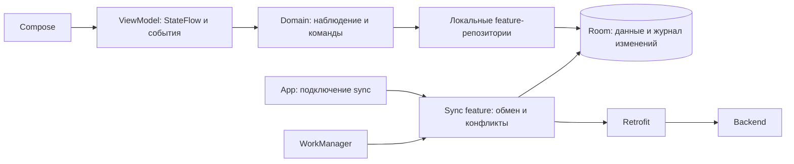

# Fillin: план перехода на offline-first и подключаемую синхронизацию

Дата исследования: 14 октября 2026. Исследован Android-клиент на коммите `bf1d862`. Документ описывает предлагаемую архитектуру и последовательность реализации; код приложения не изменён. Исходников backend и его OpenAPI-спецификации в репозитории нет, поэтому выводы о возможностях сервера ограничены клиентскими Retrofit-контрактами.

## 1. Основное решение

Сделать локальную базу единственным источником данных для экранов и местом выполнения пользовательских команд. Синхронизацию реализовать как отдельную feature, которая переносит изменения между этой базой и backend. Сохранить feature-first, слои `data/domain/ui`, Compose, Koin, MVVM и UDF.

Под «подключаемой» здесь понимаются два свойства:

- **Во время работы:** пользователь может включить, приостановить и отключить синхронизацию; локальные операции продолжают работать.
- **При сборке:** вариант `standalone` собирается без реализации sync, Retrofit, серверного токена и сетевого планировщика. Вариант `connected` содержит sync, но также работает с выключенной синхронизацией.

Это архитектура локального приложения с необязательным обменом. Хранение последнего ответа сервера можно использовать как промежуточный шаг, но оно не обеспечивает самостоятельную работу на чистой установке и после длительного отсутствия сети.

## 2. Что обнаружено в текущем приложении

| Область | Фактическое устройство | Следствие для перехода |
| --- | --- | --- |
| Модули | В [settings.gradle.kts](/Users/firkatdavletov/AndroidStudioProjects/Fillin/settings.gradle.kts:26) подключён только `:app`; feature разделены пакетами | Границы уже понятны, но необязательность сетевого кода пока не контролируется сборкой |
| DI | [AppModule](/Users/firkatdavletov/AndroidStudioProjects/Fillin/app/src/main/java/com/firkat/fillin/core/di/AppModule.kt:55) создаёт Retrofit, пять API и пять сетевых репозиториев; [FillinApplication](/Users/firkatdavletov/AndroidStudioProjects/Fillin/app/src/main/java/com/firkat/fillin/FillinApplication.kt:8) подключает один модуль | Нужно разделить локальную композицию и композицию интеграции |
| Чтение и запись | Все `*RepositoryImpl` выполняют HTTP; перед обращением проверяют `apiToken` | Без backend или токена основные сценарии недоступны |
| Хранение | В исходниках и зависимостях нет Room, DataStore и очереди фоновой работы | Данные экранов не сохраняются как постоянная локальная модель |
| Domain | Чтение — разовые `suspend get...`; исключения domain включают `MissingApiToken`, `Unauthorized`, `Network` | Контракты чтения нужно сделать наблюдаемыми, ошибки интеграции отделить от ошибок локальных операций |
| UI | ViewModel используют `StateFlow`, но наполняют его разовыми запросами. Категории и покупки обновляются вручную; доходы и расходы перечитываются после команд | Состояние не обновляется автоматически при изменениях на других экранах или фоновом обмене |
| История | [PurchaseHistoryViewModel](/Users/firkatdavletov/AndroidStudioProjects/Fillin/app/src/main/java/com/firkat/fillin/feature/purchasehistory/ui/PurchaseHistoryViewModel.kt:134) очищает список при `reload`; серверный `Long` cursor хранится в памяти | Нужны локальная пагинация, сохранённое покрытие истории и отдельный курсор обмена |
| Конкурентные изменения | Доходы, покупки, правила и экземпляры расходов имеют `version`. Категории версии не имеют. Репозитории доходов и покупок проверяют увеличение версии ровно на один | Серверную версию нельзя использовать как счётчик локальных правок; для категорий нужен дополнительный контракт |
| Правила расходов | [PlannedExpenseRule](/Users/firkatdavletov/AndroidStudioProjects/Fillin/app/src/main/java/com/firkat/fillin/feature/plannedexpenses/domain/model/PlannedExpense.kt:48) и DTO правила содержат только `id/version`; `GET` возвращает экземпляры расходов на серверный горизонт | Из ответа невозможно восстановить расписание существующего правила и генерировать новые периоды без сервера |
| Dashboard | [Dashboard](/Users/firkatdavletov/AndroidStudioProjects/Fillin/app/src/main/java/com/firkat/fillin/feature/dashboard/domain/model/Dashboard.kt:6) получает готовые баланс, резервы, прогноз и статистику; repository только преобразует DTO | Нужно получить исходные финансовые данные и спецификацию вычислений; текущей истории покупок недостаточно |
| Покупки | DTO содержит `category.id`, но [Purchase](/Users/firkatdavletov/AndroidStudioProjects/Fillin/app/src/main/java/com/firkat/fillin/feature/purchasehistory/domain/model/Purchase.kt:6) сохраняет только имя категории. Сумма в KZT приходит вместе с исходной валютой | Нужны связи по ID и явная политика пересчёта валют |
| Создание фактических операций | В `PurchaseHistoryRepository` есть чтение, изменение суммы и возврат, но нет создания. [onAddOperation](/Users/firkatdavletov/AndroidStudioProjects/Fillin/app/src/main/java/com/firkat/fillin/MainActivity.kt:91) открывает историю | Для самостоятельного учёта на чистой установке потребуется ввод фактических расходов/доходов либо явно ограниченный объём первой версии |

Полезная основа уже есть: domain-интерфейсы отделены от Retrofit, команды вынесены в use case, суммы используют `BigDecimal`, отмена coroutine не превращается в обычную ошибку. Существующие тесты проверяют валидацию, точность сумм, серверные версии, различие правила и экземпляра расхода. Эти проверки нужно сохранить и распределить между локальным domain и адаптером sync.

## 3. Целевая архитектура и границы



Сначала внедрить границы пакетами внутри `:app`, чтобы перенос Gradle-модулей не смешивался с изменением поведения. Затем вынести общие контракты, хранилище и sync в модули. Все пять бизнес-feature сразу дробить на отдельные Gradle-модули необязательно.

| Граница | Ответственность | Допустимые зависимости |
| --- | --- | --- |
| `core/model` | Общие ID, деньги, бюджет, время; только действительно общие типы | Kotlin/JDK |
| `core/database` | Одна Room-база, миграции, DAO, транзакции, журнал локальных изменений, узкие порты импорта/экспорта | `core/model`, Room |
| `feature/categories`, `plannedincomes`, `plannedexpenses`, `purchasehistory`, `dashboard` | Свои `domain/data/local/ui`, валидация, команды и наблюдение локальных данных | Общие контракты и локальное хранилище; публичный domain категорий для выбора категории |
| `feature/sync/api` | Контракт управления sync и его состоянием для приложения | Kotlin/coroutines; без Retrofit и WorkManager |
| `feature/sync/impl` | Retrofit API/DTO, mapping, обмен, auth, серверные версии, конфликты, worker, настройки интеграции | `sync/api`, локальные порты хранилища, сетевые и фоновые библиотеки |
| `app` | Навигация, выбор реализации, подключение Koin и WorkerFactory | Бизнес-feature; реализация sync только в `connected` |

Схема Room централизована для атомарных операций между feature, а таблицы и DAO внутри хранилища сгруппированы по предметным областям. Domain и UI остаются feature-first. Модуль database не импортирует реализации feature, иначе возникнет цикл зависимостей; преобразования Entity ↔ Domain выполняют локальные репозитории, Entity ↔ DTO — sync-адаптеры.

Репозитории не должны зависеть от `SyncManager`, токена или доступности сети. Они записывают локальные данные и журнал в одной транзакции. Feature sync самостоятельно читает журнал и применяет входящие изменения через локальные порты, не вызывая пользовательские команды повторно. Так импорт не создаёт бесконечную очередь обратной отправки.

### Контракты и DI

Разовые операции чтения заменить на `ObserveCategories`, `ObservePlannedIncomes`, `ObservePlannedExpenses`, `ObserveDashboard`; для истории — наблюдаемый локальный запрос с пагинацией. Команды оставить `suspend`, но успешное завершение означает сохранение на устройстве. Для конкурентного редактирования внутри устройства можно передавать `expectedLocalRevision`, отдельно от версии backend.

Пример направления изменения контракта:

```kotlin
interface CategoriesRepository {
    fun observeCategories(): Flow<List<Category>>
    suspend fun createCategory(command: CreateCategoryCommand): CategoryId
    suspend fun updateCategory(command: UpdateCategoryCommand)
    suspend fun deleteCategory(command: DeleteCategoryCommand)
}

interface SyncController {
    val state: StateFlow<SyncState>
    suspend fun enable(connection: SyncConnection)
    suspend fun disable()
    suspend fun requestSync()
}
```

Это эскиз контрактов, не готовый код для вставки. Бизнес-feature используют только собственные репозитории; `SyncController` нужен оболочке приложения и экрану sync.

Разделить `AppModule` на database, локальные feature-модули и модуль sync. Локальные репозитории регистрируются всегда. `connected` добавляет реализацию `SyncController`, WorkerFactory и сетевые зависимости; `standalone` использует `DisabledSyncController` и скрывает настройку подключения. Регистрацию выбирать явно, без переопределения одних и тех же Koin bindings.

## 4. Локальная модель: хранить факты, вычислять представления

Создать одну базу с `budgetId` во всех финансовых данных. На первой версии достаточно одного локального бюджета; его идентичность должна существовать до входа в backend. Связь с аккаунтом/семьёй добавляется при подключении и не меняет первичные ключи объектов.

| Данные | Что хранить и зачем |
| --- | --- |
| Категории | Стабильный UUID, имя, kind, iconCode, локальная ревизия, отметка удаления; ссылки из операций по ID |
| Плановые доходы | Категория, сумма/валюта, dueOn, состояние, локальная ревизия. Просрочку вычислять относительно текущей даты |
| Правила расходов | Полная модель: категория, сумма/валюта, weekly/monthly, scheduleValue, startsOn, окончание/активность и ревизия |
| Экземпляры расходов | Связь с правилом, дата, плановая сумма, состояние закрытия, связи с фактическими оплатами. Уникальный ключ согласовать как идентичность правила + дата/идентичность периода |
| Фактические операции | Расходы, фактические доходы, возвраты, связи с плановыми оплатами, дата, категория, исходная и учётная сумма; нужен источник баланса |
| Настройки бюджета | Начальный баланс с датой, базовая валюта, резервы/цели и параметры расчётов, необходимые для dashboard |
| Журнал изменений | sequence, changeId, budgetId, тип объекта/команды, локальный ID, ревизия, версия payload, зависимости, неизменяемое содержимое команды |
| Метаданные sync | Отдельные таблицы: связь с backend/account, remoteId, подтверждённая remoteVersion, базовый серверный snapshot, ack изменений, cursor, конфликты, покрытие данных |

UUID создаётся до записи и остаётся стабильным. Предпочтительно backend принимает clientId и возвращает его. Если backend оставляет свои ID, sync хранит mapping `localId ↔ remoteId`; UI и внешние ключи никогда не переключаются на серверные ID. Для уже существующих объектов сохранять связь с remoteId при первоначальном импорте.

`localRevision` увеличивается при локальной команде. `remoteVersion` меняется только после подтверждения сервера или получения его состояния. Несколько offline-правок не должны автоматически превращаться в `remoteVersion + N`.

Деньги хранить точно: для текущего KZT — целое число минимальных единиц с проверкой переполнения либо точная десятичная строка с вычислениями в `BigDecimal`; выбрать один формат и правила округления. Не использовать `Float/Double` для финансовых сумм. Исходная валюта покупки и её KZT-оценка — отдельные данные. Для offline-изменения иностранной суммы нужен сохранённый курс/правило оценки; отсутствие курса нельзя маскировать случайным пересчётом.

Плановые даты хранить как `LocalDate`/epoch day, технические timestamps — UTC `Instant`. Внедрить источник времени и зону бюджета; начальное поведение сохранить для `Asia/Almaty`. Смена дня, месяца или года должна обновлять просрочку, период и прогноз даже без изменений в Room: сигнал даты на открытии/возобновлении экрана и при смене дня в активном приложении.

### Особенности пяти feature

- **Categories:** первой перевести на Room CRUD и Flow. Для удаления связанных категорий выбрать правило domain: запрет удаления используемой категории либо архивирование. Исторические названия можно сохранять снимком, но связи строить по ID. Emoji для локального создания брать из текущего `CategoryIconType`.
- **Planned incomes:** наблюдать доходы и категории из базы; успех команды больше не ждёт HTTP. Сохранять существующую валидацию даты, но не путать её с датой доставки: доход, созданный сегодня offline, может синхронизироваться через неделю. Backend должен принимать исходную дату по согласованному контракту.
- **Planned expenses:** вынести генерацию периодов в чистый domain-компонент. Зафиксировать поведение для 29–31 числа, ISO-дней недели, startsOn, изменения суммы правила, удаления правила и сохранения уже оплаченных периодов. Генерация должна быть повторяемой и не создавать дубликатов; клиент и backend согласуют идентичность экземпляра. Производные периоды не отправлять как независимые новые расходы, если сервер тоже генерирует их.
- **Purchase history:** сохранить `categoryId`, показывать локальный список и использовать Room PagingSource или локальную keyset-пагинацию. Курсор страниц backend и курсор списка UI разделить. Возврат, несмотря на текущий HTTP DELETE, моделировать как бизнес-команду с финансовым эффектом; не удалять историю как обычную tombstone. При закрытии частично оплаченного планового расхода не создавать фиктивную дополнительную оплату: отдельно хранить факт закрытия и согласованную семантику остатка.
- **Dashboard:** реализовать `CalculateDashboard` над согласованным локальным набором операций, начального баланса, правил, резервов и настроек. Наблюдать изменения базы и времени; связанные показатели считать из одного согласованного snapshot, чтобы не показывать смесь состояний до/после команды. Кэш `DashboardDto` допустим временно с датой актуальности, но не удовлетворяет конечному критерию автономности.

Формулы forecast, safeDailyLimit, protectedReserve, goalReserve и paceStatus нельзя достоверно вывести только из DTO. Получить спецификацию/backend-реализацию и контрольные примеры. Добавить недостающий минимальный локальный ввод фактических операций и настроек бюджета; плановый доход не считать фактически полученными деньгами. Если эти сценарии откладываются, обозначить этап как offline-работу с планами и сохранёнными данными, а не полную автономность dashboard.

## 5. Журнал и протокол обмена

### Атомарность и работа без sync

Пользовательская команда выполняет локальную валидацию и одной Room-транзакцией изменяет данные, увеличивает локальную ревизию и добавляет запись журнала. Результат появляется в UI через Flow. Операция должна сохраниться и при отсутствии sync-модуля; callback планировщика не является условием успеха.

Журнал — инфраструктура фиксации локальных изменений, а HTTP/outbox-доставка — ответственность sync. Для долгой работы без подключённого backend предусмотреть checkpoint и безопасное сокращение журнала: первое подключение экспортирует текущий snapshot, последующие — изменения после подтверждённой границы. Семантически значимые факты возвратов/закрытий остаются в финансовой модели, даже если технический журнал сокращён. Историю, нужную ранее подключённому, но приостановленному backend, не удалять до ack или явной процедуры переподключения.

Удаление синхронизируемого объекта сохраняется как tombstone. Скрыть его из активных списков можно сразу, физически удалить — после подтверждения и согласно общей политике удержания удалений/восстановления отставших клиентов. Подтверждение одним устройством не доказывает, что все семейные устройства уже увидели удаление.

### Один цикл sync

1. Проверить включение интеграции, budget/account и поколение подключения. Загрузить сохранённые cursor и неподтверждённые изменения. Один обмен на конкретный бюджет/подключение выполняется последовательно.
2. Получить серверные изменения с последнего cursor. Применить их с учётом pending-правок, tombstone и зависимостей: чистые записи обновить, пересечения передать обработчику конфликтов. Применение страницы и продвижение её cursor выполнить атомарно; связанные данные при необходимости сначала собрать во временный snapshot.
3. Подготовить отправку независимых команд в порядке зависимостей: создание категории до дохода/правила, правило до команды закрытия экземпляра. Зафиксировать неизменяемые commandId, payload и baseVersion до HTTP. Повтор после таймаута использует ту же команду и тот же ключ идемпотентности.
4. Отправить команды. В одной локальной транзакции сохранить ack, mapping и подтверждённую remoteVersion. Подтверждение правки N не должно затирать локальную правку N+1, сделанную во время запроса. Следующую команду того же объекта готовить с учётом подтверждения предыдущей.
5. Дочитать серверные изменения и вычисленные сервером факты. Повторить до опустошения очереди либо ограничения длительности/размера партии; сохранить состояние продолжения.

Доставка должна допускать повтор, а серверный эффект — быть идемпотентным. Простой повтор POST без server-side дедупликации создаёт дубликаты; обработка `409` не заменяет идемпотентность.

### Конфликты

Не использовать безусловное «последняя правка по времени устройства побеждает» для сумм, возвратов и закрытий. Часы устройств могут расходиться, а скрытая потеря финансовой правки недопустима.

Хранить последний подтверждённый server snapshot и сравнивать base/local/remote. Независимые изменения разрешённых полей можно объединять по явной политике. Разные суммы одного объекта, delete/update и противоречащие возврат/закрытие сохранять как конфликт с обеими версиями. Блокировать только зависимые команды этого объекта, продолжать обмен независимых объектов. Экран sync предлагает выбрать состояние или внести исправление; выбор создаёт новую команду с актуальной серверной базой. Повтор уже подтверждённого commandId возвращает исходный результат.

### Запуск и ошибки

Планировщик находится внутри sync-feature. Запускать обмен после подключения, локальной записи, ручного запроса и на старте подключённого приложения. Добавить периодический проход для входящих изменений и восстановления после падения между commit базы и постановкой работы.

WorkManager использовать с сетевым constraint, unique work на подключение и backoff. Его периодическая работа имеет минимальный интервал 15 минут и не обещает точного времени запуска; не обещать мгновенное обновление между семейными устройствами. Основание: [Define work requests](https://developer.android.com/develop/background-work/background-tasks/persistent/getting-started/define-work).

Защитить гонку «новая запись после последней проверки очереди, но до завершения worker». Например, ставить продолжение через `APPEND_OR_REPLACE` и объединять частые запросы запуска, сохраняя завершающий проход. Простого `KEEP`, который может отбросить последний запрос при ещё работающем worker, недостаточно без дополнительного механизма. Проверить политику на выбранной версии библиотеки; [Managing work](https://developer.android.com/develop/background-work/background-tasks/persistent/how-to/manage-work) описывает unique work и связанные политики.

| Результат | Поведение |
| --- | --- |
| Нет сети, timeout, временный 5xx, 429 | Сохранить очередь; повторить с backoff, учитывать Retry-After |
| 401 / истёкшая авторизация | Приостановить доставку до восстановления авторизации; локальные команды доступны |
| 403 | Показать ограничение подключения/прав; не повторять бесконечно |
| 409 / нарушение baseVersion | Сохранить конфликт; повтор после явного разрешения |
| 400/422 | Сохранить непринятую команду и причину для исправления; не отбрасывать локальные данные |
| 404 | Разобрать как удаление, неизвестный mapping или устаревшую команду согласно протоколу; не считать любой 404 успешным удалением |

При выключении sync сначала изменить поколение/статус подключения, затем отменить его работы. Worker проверяет статус между партиями и перед отправкой. Уже отправленный запрос может завершиться; его подтверждение нужно корректно сохранить или восстановить по commandId при следующем подключении. Смена аккаунта не должна отправлять старую очередь в другой бюджет: mapping, ack и cursor привязаны к backend/account/budget. Worker принимает ID подключения, а не секреты через входные данные.

## 6. Требования к backend и первоначальному подключению

Ниже — необходимые возможности, не подтверждённые в текущем клиенте. Их можно реализовать отдельными sync-endpoint или расширением существующих REST-ресурсов.

| Требование | Зачем и какой пробел виден сейчас |
| --- | --- |
| ClientId либо безопасный mapping, идемпотентный commandId | В create DTO нет clientId/ключа повтора; без контракта нельзя гарантировать отсутствие дублей после потери ответа |
| Версии всех изменяемых ресурсов | Категории сейчас без version; остальные ресурсы частично поддерживают optimistic locking |
| Change feed с cursor, удалениями и стабильной пагинацией | Текущие GET экранов не описывают дельты, tombstone и согласованный snapshot |
| Полные правила расходов и идентичность экземпляров | Сейчас правило возвращает только id/version, расписание известно лишь в create-запросе |
| Исходные операции, баланс, резервы, настройки/формулы | Dashboard возвращает итоговые показатели; фактических доходов и полного источника баланса в клиенте нет |
| Передача локально созданных операций | В текущем API истории нет POST покупки; нужен контракт, если приложение создаёт их самостоятельно |
| Дата бизнес-операции и дата доставки | Offline-команда должна оставаться валидной после нескольких дней ожидания, в том числе плановый доход с уже прошедшей dueOn |
| Срок хранения feed/tombstone и ответ на истёкший cursor | Нужна безопасная повторная загрузка без воскрешения удалённых данных |
| Scope семьи/бюджета и авторизация | Текущий токен берётся из BuildConfig; жизненный цикл пользовательского подключения в клиенте не реализован |

При первом подключении снять локальный snapshot на ревизии R и согласованный серверный snapshot с watermark; изменения после R остаются в журнале для следующего прохода. При непустой локальной и серверной базе предоставить конкретный выбор: загрузить серверный бюджет как отдельный локальный, отправить локальный в новый удалённый бюджет либо выполнить согласованное объединение с проверкой конфликтов. Не удалять локальную базу автоматически и не объединять категории только по имени.

При импорте покупок сохранить все страницы и состояние покрытия. Отсутствие записи на отдельной странице или в ограниченном горизонте planned-expenses не означает удаление. Неполную историю нельзя выдавать за полный баланс/статистику; dashboard должен учитывать явную полноту данных. Если сервер не предоставляет согласованный snapshot, дельты, удаления и идемпотентность, сначала выпустить локальный режим и ограниченный импорт. Полноценный двусторонний обмен в таком случае остаётся отдельным незавершённым этапом.

## 7. Последовательность реализации

Каждый этап завершать проверяемым изменением. Локальную часть можно делать независимо от готовности sync-протокола; исследование backend начать на первом этапе, чтобы заранее уточнить финансовую модель.

| Этап | Изменения | Критерий завершения |
| --- | --- | --- |
| 0. Зафиксировать контракт | ADR: смысл standalone/connected, границы автономности, модель бюджета, деньги/время, правила расходов и возвратов; исследовать backend и контрольные примеры dashboard | Есть список исходных данных и утверждённые правила; серверные пробелы превращены в отдельные задачи |
| 1. Локальный фундамент | Room, экспорт схемы/миграции, UUID, Clock/зона, транзакции и журнал; Koin database module. DataStore — только для настроек подключения, не для финансовых таблиц | Данные и запись журнала атомарны и переживают перезапуск; совместимые версии библиотек проверены с текущими AGP/Kotlin |
| 2. Categories как вертикальный срез | LocalRepository, DAO Flow, ObserveCategories, локальный CRUD, новый смысл ошибок и успеха UI | Чистая установка без токена позволяет создать/изменить категорию; изменения видны во всех подписчиках |
| 3. Плановые доходы | Room, наблюдение категорий и доходов, локальные команды/ревизии, время через общий источник | Offline CRUD сохраняется после перезапуска; изменение категории и смена даты обновляют экран |
| 4. Правила и расходы | Полная модель правил, генератор периодов, связи оплат, локальное закрытие и удаление, импорт существующих правил при наличии контракта | Без сервера создаются будущие периоды, включая смену года; нет дублей и потери оплаченной истории |
| 5. Фактические операции и история | Нормализованная история, categoryId, локальная пагинация, refund/update; минимальный ввод фактических доходов/расходов и начального баланса для самостоятельного бюджета | История и финансовые эффекты команд работают offline; локальный cursor не зависит от API |
| 6. Автономный dashboard | CalculateDashboard, недостающие настройки/резервы, согласованные snapshots и обновление по дате; сверка с backend-примерами | На чистой установке dashboard рассчитывается локально; pending-правки сразу меняют показатели; неполные данные явно обозначены |
| 7. Подключаемый sync | Отдельные `sync/api` и `sync/impl`, перенос Retrofit/DTO/token из бизнес-feature, backend-контракт, bootstrap, push/pull, ack/mapping, конфликты, worker, экран подключения | Два устройства сходятся после восстановления сети; выключение sync сохраняет локальную работу и очередь |
| 8. Изоляция сборки и выпуск | Выделить общую модель/хранилище, если ещё внутри app; standalone/connected source sets и зависимости; миграции, обработка восстановления базы, проверки обеих сборок | Standalone собирается без sync implementation/Retrofit/WorkManager и не требует API-токена; connected проходит проверки отказов |

Первые изменения стоит делать в `gradle/libs.versions.toml`, `app/build.gradle.kts`, `core/database`, Koin-модулях и `feature/categories`. Они дадут небольшой законченный срез, на котором можно проверить всю модель чтения и записи до переноса более сложных расчётов.

Кэширование HTTP и автоматический refresh каждого экрана не должны стать конечной реализацией. После этапа 7 все `feature/*/data/remote` переносятся в sync; основной domain больше не содержит обязательных ошибок отсутствия API-токена. Сетевые настройки `API_BASE_URL/MOBILE_API_TOKEN` уходят в композицию connected/управление подключением. Room не использовать с destructive migration для пользовательских данных.

## 8. Проверки и критерии готовности

Существующие unit-тесты валидации и финансовой точности сохранить. Проверки HTTP-кодов, авторизации и серверных версий перенести к sync-адаптерам; тест «нет токена — операция запрещена» больше не должен описывать локальный репозиторий.

- **Локальная база:** commit данных и журнала вместе; rollback при ошибке; UUID/FK; удаление связанной категории; миграции сохранённых схем; перезапуск процесса после записи.
- **Domain:** точные суммы/округление и исходная валюта; плановые доходы не увеличивают фактический баланс; частичная оплата/закрытие/возврат; месяцы разной длины, високосный год и смена зоны/даты; повторная генерация без дублей; соответствие dashboard контрольным примерам.
- **UI:** сохранение при авиарежиме, пустая локальная база, обновление между экранами через Flow, история без очистки при sync, ошибка обмена не превращает сохранённую команду в ошибку редактора.
- **Sync:** сервер применил команду, но ответ потерян; приложение упало до ack; появилась новая локальная правка во время HTTP; category create предшествует зависимым командам; две offline-правки одной суммы; update/delete, повтор refund/close; incoming-импорт не создаёт echo.
- **Жизненный цикл:** отключение во время запроса, изменение аккаунта, истечение авторизации/cursor, восстановление после длительного offline, новая запись перед завершением worker, неполные страницы истории, повторы после восстановления backup.
- **Сборка:** проверка dependency graph standalone и connected; Koin запускается в обеих конфигурациях, все пять экранов доступны без sync; основные feature не импортируют sync implementation или Retrofit.

Итоговый сценарий приёмки: на чистой установке без интернета и API-токена пользователь создаёт локальный бюджет, категории, планы и фактические операции, видит локально рассчитанный dashboard; данные переживают перезапуск и смену месяца. Позже подключает backend, получает явные результаты импорта/обмена и разрешает конфликты. После отключения интеграции те же локальные сценарии продолжают работать.

При добавлении постоянной базы уточнить существующие `backup_rules.xml` и `data_extraction_rules.xml`: финансовые данные и журнал сохраняются согласованно, секреты подключения исключаются, а восстановленный экземпляр переустанавливает идентичность устройства и проверяет состояние обмена. Одного восстановления старого cursor недостаточно.

## 9. Основания для технических решений

Android рекомендует читать данные offline-first приложения из локального источника и фиксировать критичные изменения локально до сетевой доставки. Это основа предложенного направления; конкретные границы sync, финансовая модель и протокол выше — проектные решения для Fillin. [Build an offline-first app](https://developer.android.com/topic/architecture/data-layer/offline-first).

Room поддерживает наблюдаемые запросы через Flow и разовые операции через suspend; это позволяет обновлять экраны от базы вместо ручного перечитывания после каждого HTTP-запроса. [Write asynchronous DAO queries](https://developer.android.com/training/data-storage/room/async-queries).

WorkManager предоставляет ограничения запуска, retry/backoff и управление unique work. Он отвечает за выполнение фонового обмена, а долговечность и порядок финансовых команд обеспечивает журнал в базе. [Define work requests](https://developer.android.com/develop/background-work/background-tasks/persistent/getting-started/define-work), [Managing work](https://developer.android.com/develop/background-work/background-tasks/persistent/how-to/manage-work).
